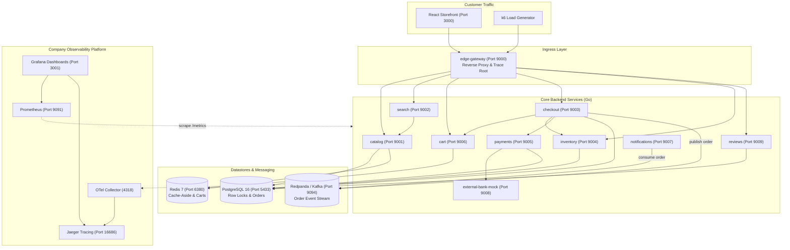

# ShopKart - Distributed E-Commerce Architecture

ShopKart is a production-grade, microservice-based e-commerce platform designed with realistic bounded resources, authentic failure mechanics, and vendor-neutral observability tooling.

Failures and latency in ShopKart stem from **real load and authentic fault mechanics** (such as database connection exhaustion, row-level locks, cache stampedes, network jitter, and consumer lag)—never through simulated fake delays or mock demo UI toggles.

---

## 1. System Architecture



---

## 2. Port Allocation Reference

All host ports have been configured to avoid colliding with typical local developer services:

| Component / Service | Host Port | Internal Port | Description |
| :--- | :--- | :--- | :--- |
| **Storefront UI** | `3000` | `3000` | React + TypeScript + Tailwind Customer Storefront |
| **edge-gateway** | `9000` | `9000` | API Gateway with CORS & dynamic DNS round-robin |
| **catalog** | `9001` | `9001` | Product catalog with Redis cache-aside |
| **search** | `9002` | `9002` | Search & category query service |
| **checkout** | `9003` | `9003` | Order orchestration & Kafka producer |
| **inventory** | `9004` | `9004` | Stock management with row-level locks |
| **payments** | `9005` | `9005` | Card charge & idempotency ledger |
| **cart** | `9006` | `9006` | Redis-backed shopping cart |
| **notifications** | `9007` | `9007` | Kafka consumer with real consumer lag |
| **external-bank-mock** | `9008` | `9008` | External payment partner simulator |
| **reviews** | `9009` | `9009` | Customer review submission & ratings |
| **PostgreSQL** | `5433` | `5432` | Relational database (orders, inventory, products) |
| **Redis** | `6380` | `6379` | In-memory cache and cart datastore |
| **Kafka / Redpanda** | `9094` | `9092` | Event broker for async order events |
| **Prometheus** | `9091` | `9090` | Metrics collection and TSDB |
| **Grafana** | `3001` | `3000` | Observability dashboards (`admin` / `admin`) |
| **Jaeger UI** | `16686` | `16686` | Distributed trace visualizer |

---

## 3. Quick Start (Lightweight & Fast)

Instead of building 11 heavy container images inside Docker, ShopKart runs infrastructure datastores (PostgreSQL, Redis, Kafka, Prometheus, Grafana, Jaeger) as instant prebuilt Docker containers, while running Go backend services and Vite storefront natively on your machine.

### Step 1: Start Infrastructure Datastores (3 seconds, zero builds)
```powershell
cd shopkart
.\run.ps1 infra
# (Or: docker compose up -d)
```

### Step 2: Start All 10 Go Services (Native Go runtime)
In a new terminal:
```powershell
cd shopkart
.\run.ps1 backend
# (Or: cd services; go run main.go)
```
This boots all 10 Go services (`9000`-`9009`) in ~1 second.

### Step 3: Start the Storefront UI (Native Vite)
In a new terminal:
```powershell
cd shopkart
.\run.ps1 storefront
# (Or: cd storefront; npm run dev)
```
The storefront is now available instantly at **[http://localhost:3000](http://localhost:3000)**!

### 3. Verify Health
Open [http://localhost:3000](http://localhost:3000) in your browser to explore the store. The bottom status bar shows live latency measurements from edge-gateway requests.

Check readiness of core services:
```bash
curl http://localhost:9000/readyz
curl http://localhost:9003/readyz
```

---

## 4. Observability & Telemetry

### Standard Metrics Per Service
Every backend service exposes `/metrics` in Prometheus format with uniform labels:
- `service`: Name of the service
- `instance`: Host/pod identifier
- `env`: Deployment environment (`production`)

Key exposed metrics:
- `http_requests_total{service, method, path, status}`
- `http_request_duration_seconds{service, method, path}` (p50, p95, p99 histogram)
- `http_requests_in_flight{service}`
- `worker_pool_utilization_ratio{service, pool_name}`
- `db_pool_connections_in_use{service, database}`
- `db_pool_connections_wait_count{service, database}`
- `cache_hits_total{service, cache}` / `cache_misses_total`
- `consumer_lag{topic, group}` / `queue_depth`
- `process_resident_memory_bytes` / `go_goroutines`

### Grafana Dashboards
Navigate to [http://localhost:3001](http://localhost:3001) (User: `admin`, Password: `admin`).
The **ShopKart Production Observability** dashboard is auto-provisioned, showing golden signals (Traffic, Latency, Errors, Saturation) in real time.

### Jaeger Distributed Tracing
Navigate to [http://localhost:16686](http://localhost:16686).
W3C `traceparent` headers are propagated across HTTP and Kafka messages. A single checkout request traces the path:
`edge-gateway -> checkout -> cart -> inventory -> payments -> external-bank-mock -> Kafka -> notifications`.

---

## 5. Load Testing Profiles (k6)

Run load tests from the root `shopkart/` directory:

| Test Profile | Command | Behavior Under Test |
| :--- | :--- | :--- |
| **Baseline** | `make load-baseline` | Steady browsing, adding to cart, and checkouts (10 VUs) |
| **Spike Checkout** | `make load-spike` | High concurrency checkouts saturating checkout worker pool (50 VUs) |
| **Flash Sale** | `make load-cache` | Cache stampede after eviction, causing DB pool contention |
| **Queue Flood** | `make load-queue` | Generates order volume faster than notifications can drain |
| **Mixed Realistic** | `make load-mixed` | 65% browse, 20% cart, 15% checkout traffic mix |

---

## 6. Real Fault Mechanics & Runbooks

All fault scripts are located in `scripts/`, are completely idempotent, and include matching revert scripts:

```bash
# Crash / Service Failure
make fault-crash        # Kills inventory container
make revert-crash       # Restarts inventory

# Cache Outage
make fault-cache        # Stops Redis container
make revert-cache       # Restarts Redis

# Database Contention
make fault-db           # Holds long row lock on inventory prod_01
make revert-db          # Terminates lock transaction

# DB Connection Saturation
make fault-slow-query   # Spawns 12 slow query connections
make revert-slow-query  # Cancels slow queries

# Memory Leak
make fault-memory       # Activates real memory leak path in payments
make revert-memory      # Clears leak and releases buffers

# Network Jitter / Delay
make fault-netem        # Introduces 300ms delay to bank mock
make revert-netem       # Restores normal baseline latency

# Revert Everything
make revert-all         # Restores system to clean, healthy state
```

For symptoms, trace signatures, and SRE remediation procedures, see [docs/faults.md](docs/faults.md).
For operational procedures like horizontal scaling and runtime pool resizing, see [docs/runbook.md](docs/runbook.md).
For recorded lab test observations, see [docs/results.md](docs/results.md).
